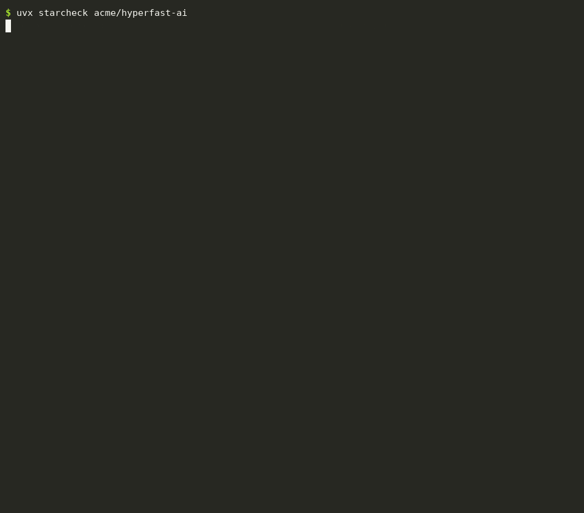

# starcheck

**GitHub stars are for sale, and millions of them are fake.** Researchers have counted [millions of bought stars](https://arxiv.org/abs/2412.13459) on GitHub, often on repos pushing malware or crypto scams. starcheck looks at who starred a repo and tells you whether the stars look real.

```bash
uvx starcheck owner/repo
```

<p align="center"></p>

<sub>Demo on a made-up repo with made-up stargazers, generated by <a href="docs/demo.py">docs/demo.py</a>. acme/hyperfast-ai doesn't exist.</sub>

## What it looks for

Bought stars come from throwaway accounts, and throwaway accounts look alike:

| Signal | |
|---|---|
| **Empty account** | no followers, no repos, no gists, nothing in the profile |
| **Brand new** | the account was made less than 30 days before it starred the repo |
| **Bursts** | hundreds of stars in one day, mostly from empty accounts |
| **Batches** | many empty accounts created on the same day, all starring the same repo |
| **No forks** | thousands of stars but almost nobody forked it |

Plenty of real people have empty accounts, so that alone means nothing. A star is counted as **suspicious only when an empty account also shows another sign**: brand new, part of a burst, or part of a batch. A launch on Hacker News makes a burst too, but of real accounts, so it doesn't count.

The result is a set of signals, not proof. starcheck never names the accounts it flags.

## Use it before you trust a repo

- Before installing a tool you found through its star count
- Before depending on a library, alongside its maintainers, downloads and issues
- To check a competitor's or a "trending" repo
- To check your own repo: if someone bought you stars (it happens, as a smear), you'll want to know

## Token

GitHub only lists stargazers to signed-in users, so starcheck needs a token. If you use the GitHub CLI it just works (`gh auth token`). Otherwise set `GITHUB_TOKEN` to any personal access token; it needs no scopes. Checking 3,000 stargazers takes 30 API calls.

## Options

```
starcheck owner/repo              # up to 3,000 stargazers
starcheck github.com/owner/repo   # URLs work too
starcheck owner/repo --max 10000  # check more (big repos are sampled from both ends of the timeline)
starcheck owner/repo --json       # for scripts and CI
```

## Install

```bash
uvx starcheck           # run without installing
pipx install starcheck  # or install it
```

Requires Python 3.9+. The only dependency is `rich`. macOS, Linux and Windows.

## License

MIT
